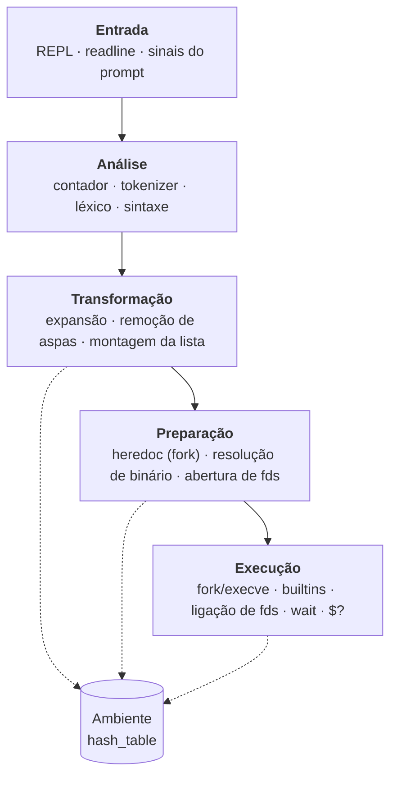

# Arquitetura — minishell (MiauShell)

> Gerado pelo **Arquiteto** (Reversa) em 2026-11-11 · nível **completo**
> Escala: 🟢 CONFIRMADO · 🟡 INFERIDO · 🔴 LACUNA

## 1. Resumo

| Aspecto | Valor |
|---------|-------|
| Estilo | **Pipe-and-filter** em processo único, orquestrado por uma **Facade** (ADR-001) 🟢 |
| Execução | Processo principal + forks (um para os heredocs, um por comando) 🟢 |
| Linguagem | C (Norminette 42), cerca de 2.900 linhas em `src/` 🟢 |
| Persistência | Nenhuma. O estado vive em memória, e o histórico do readline não é salvo em arquivo 🟢 |
| Integrações | Só chamadas de sistema POSIX e GNU Readline 🟢 |
| Estado global | `g_minishell` (ADR-007) 🟢 |
| Testes | GoogleTest, só no parser (ADR-002) 🟢 |

## 2. Documentos de arquitetura

| Documento | Conteúdo |
|-----------|----------|
| [`c4-context.md`](c4-context.md) | Sistema, usuário, kernel, programas, sistema de arquivos e terminal |
| [`c4-containers.md`](c4-containers.md) | Processo principal, filho do heredoc, filhos de comando, bibliotecas |
| [`c4-components.md`](c4-components.md) | 16 componentes do processo principal |
| [`erd-complete.md`](erd-complete.md) | Modelo de dados em memória |
| [`state-machines.md`](state-machines.md) | Sessão, linha, nó, sinais, `$?` |
| [`adrs/`](adrs/) | 10 decisões retroativas |
| [`traceability/spec-impact-matrix.md`](traceability/spec-impact-matrix.md) | Impacto entre componentes |

## 3. Visão em camadas



As camadas 1 a 3 são deterministas e quase puras. Isso explica por que só elas foram testadas. As camadas 4 e 5 têm efeitos colaterais no sistema operacional e concentram a maioria dos defeitos 🟢.

## 4. Fluxo de dados de uma linha

```
"echo $USER > out | wc -c"
  tks  = [echo, $USER, >, out, |, wc, -c]
  lex  = [WORD, VAR,   REDO, WORD, PIPE, WORD, WORD]
  tks' = [echo, luis,  >, out, |, wc, -c]         (expand_var)
  ctks = tks' sem aspas                           (clean_tokens)
  list = [echo luis] ⇄ [REDO out] ⇄ [PIPE] ⇄ [wc -c]
  bin  = builtin            —          —      /usr/bin/wc
  fds  = —            open(out,TRUNC) pipe()   —
  exec: echo → fork (não é o último nó) → stdout = out (o redirecionamento vence o pipe)
        wc   → fork → stdin = pipe.fd[0] → imprime 0
```
🟢 Montado a partir das regras do Arqueólogo.

## 5. Integrações externas

| Integração | Tipo | Uso |
|------------|------|-----|
| GNU Readline | Biblioteca | `readline`, `add_history`, `rl_on_new_line`, `rl_replace_line`, `rl_redisplay` 🟢 |
| Kernel (syscalls) | ABI POSIX | `fork`, `execve`, `pipe`, `dup`, `dup2`, `waitpid`, `signal`, `open`, `close`, `fstat`, `access`, `chdir`, `getcwd`, `write` 🟢 |
| Programas externos | `execve` | Qualquer binário. O contrato é argv + envp + fds 0/1/2 🟢 |

Não há APIs HTTP, mensageria, webhooks, banco de dados nem arquivos de configuração 🟢.

## 6. Atributos de qualidade

| Atributo | Avaliação |
|----------|-----------|
| **Corretude em relação ao bash** | Média. O caminho feliz funciona (pipes, `>`/`>>`/`<`, heredoc, builtins sozinhos), mas há 19 anomalias catalogadas, uma delas com crash 🟢 |
| **Robustez** | Baixa. Um erro de I/O em `>` derruba o shell, e várias alocações não checam `NULL` 🟢 |
| **Manutenibilidade** | Média. A separação por pastas é clara, mas o acoplamento por `t_line` é implícito, há discriminadores em string e lógica de contagem duplicada 🟢 |
| **Testabilidade** | Alta no parser e nula no resto 🟢 |
| **Desempenho** | Adequado para uso interativo. Há um fork extra por linha (heredoc) 🟢 |
| **Portabilidade** | Linux e macOS com libreadline. Depende de detalhes do `union` e de `__UINT64_MAX__` 🟡 |

## 7. Dívidas técnicas

| ID | Dívida | Tipo | Impacto | Onde |
|----|--------|------|---------|------|
| DT-01 | **Duas implementações das regras de tokenização** (`count_tks` e `tokenizer`) que precisam concordar | Duplicação | Alto: uma divergência causa estouro de buffer | `tokens/count_tks.c`, `tokens/tokenizer.c` |
| DT-02 | **Categorias e papéis em string** comparadas com `ft_strncmp` por prefixo em cerca de 64 lugares | Padrão inconsistente | Médio: falsos positivos (`pwdx`, `PIPEx`) | todo o código |
| DT-03 | **Ambiente duplicado**: a hash table e o `envp` original, sem sincronização | Arquitetural | Alto: `export` invisível para os filhos | `exec_path.c:34` |
| DT-04 | **Ligação comando↔redirecionamento por posição** em vez de agrupamento por segmento de pipeline | Modelo de dados | Alto: redirecionamentos antes do comando falham | `fd_handler.c` |
| DT-05 | **Union `bin`/`fd`** no mesmo nó | Modelo de dados | Médio: leituras inválidas | `minishell.h` |
| DT-06 | **Tratamento de erro inconsistente**: mistura de stdout e stderr, `printf("!ERROR!")`, `free_line` no meio de um loop, `malloc` sem checagem | Robustez | Alto (crash) | `free.c`, `fd_handler_utils.c`, `arr_utils.c` |
| DT-07 | **Status code espalhado**: escrito por builtins, handlers, heredoc e wait no mesmo campo | Acoplamento | Médio | `exec_list.c`, builtins, `signals.c` |
| DT-08 | **Testes só no parser**; nenhum teste de integração do binário | Testes | Alto | `tests/` |
| DT-09 | **Suíte de testes possivelmente quebrada** (`#include` de `.c`, lib `ft` incompleta no CMake) | Build | Médio | `tests/CMakeLists.txt` |
| DT-10 | **Campos mortos**: `t_line.fd`, `t_line.sig`, `t_hash_table.count`, `s_export.counter`; função `print_array` de debug | Código morto | Baixo | vários |
| DT-11 | **Hash aditiva** com muitas colisões (anagramas) e remoção defeituosa | Algoritmo | Médio | `hash_table/` |
| DT-12 | `readline.supp` e versões de ferramentas fora do repositório | Build | Baixo | `Makefile` |
| DT-13 | Fork do heredoc em toda linha; buffer de stdio não esvaziado antes do `fork` | Desempenho e corretude | Médio (saída duplicada) | `facade.c:40` |
| DT-14 | Handlers de sinal chamam funções que não são *async-signal-safe* | Robustez | Baixo | `signals*.c` |

## 8. Pontos de extensão naturais

- **Novo operador** (por exemplo `&&`): token em `tokenizer` e `count_tks` → categoria em `find_lexema` → regra em `sintax_analysis` → tamanho em `get_arg_size` → semântica em `exec_list` 🟡.
- **Novo builtin**: `is_a_builtin`, `exec_builtins` e um arquivo em `builtins/` 🟢.
- **Variáveis especiais** (por exemplo `$$`): chave na tabela e delimitador em `key_len` 🟡.
