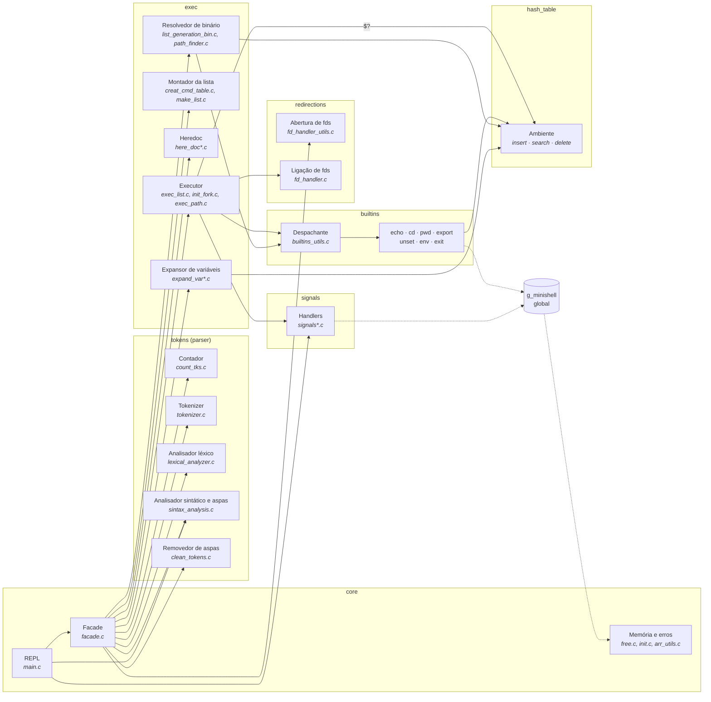

# C4 Nível 3: Componentes (processo principal)

> Gerado pelo **Arquiteto** (Reversa) em 2026-11-11

## Responsabilidades

| Componente | Entradas | Saídas | Observações |
|------------|----------|--------|-------------|
| REPL | stdin | `line.str` | Faz a checagem de aspas **antes** da Facade |
| Facade | `line.str` | efeitos colaterais | Ordem fixa dos filtros (ADR-001) |
| Contador + Tokenizer | `str` | `tks_nbr`, `tks` | Duas implementações das mesmas regras (ADR-003) |
| Analisador léxico | `tks` | `lex` | Categorias em forma de string |
| Analisador sintático | `lex` | bool | Também contém `verify_quots` |
| Expansor | `tks`, `lex`, tabela | `tks` alterado | Roda **antes** da remoção de aspas |
| Removedor de aspas | `tks` | `ctks` | |
| Montador da lista | `ctks`, `lex` | `list_cmds` | ADR-005 |
| Heredoc | nós `HERE` | conteúdo nos pipes | ADR-006, em processo filho |
| Resolvedor | nós de comando, tabela (`PATH`) | `node->bin` | Builtin detectado por prefixo |
| Abertura de fds | nós de operador | `node->fd` | Roda no pai, antes dos forks |
| Executor | lista | processos, `$?` | ADR-009 |
| Ligação de fds | nó de comando | `dup2` | Roda no filho |
| Builtins | nó | stdout, tabela | Usa a global para gravar o status |
| Ambiente | chave/valor | — | ADR-004 |
| Sinais | sinal | `\n`, status, exit | Usa a global (ADR-007) |
