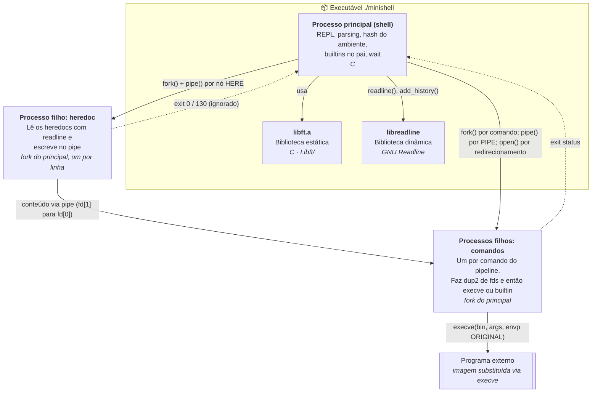

# C4 Nível 2: Containers

> Gerado pelo **Arquiteto** (Reversa) em 2026-11-11

O minishell é **um único executável**. Em tempo de execução, porém, ele cria **processos** com papéis diferentes. Para um shell, os "containers" relevantes são esses processos e as bibliotecas ligadas ao binário.

| Container | Tecnologia | Responsabilidade | Ciclo de vida |
|-----------|------------|------------------|---------------|
| Processo principal | C + readline | Todo o pipeline até `open_fds`, builtins no último nó, `waitpid`, `$?` | Sessão inteira 🟢 |
| Filho do heredoc | C (fork) | Ler heredocs com isolamento de SIGINT | **Toda linha válida**, mesmo sem `<<` 🟢 |
| Filhos de comando | C (fork) → `execve` | Ligar stdin e stdout (pipes, arquivos) e executar | Um por comando que não roda no pai 🟢 |
| libft.a | C estático | Strings e memória | Compilada junto 🟢 |
| libreadline | Biblioteca do sistema | Edição de linha e histórico | Dinâmica 🟢 |
| Suíte de testes `runTests` | C++ / GoogleTest / CMake | Testes unitários de `tokens/` | Build separado, fora do Makefile 🟢 |

## Comunicação entre processos

| De → Para | Mecanismo | Dados |
|-----------|-----------|-------|
| Principal → filho do heredoc | Memória herdada pelo fork | Lista de nós com os delimitadores |
| Filho do heredoc → filho de comando | `pipe()` criado pelo principal | Texto do heredoc |
| Filho de comando → filho de comando | `pipe()` criado pelo principal em `open_fds` | stdout → stdin |
| Filhos → principal | `waitpid` | Status de saída |
| Principal → filhos | Herança de fds e do `envp` original | Ambiente (sem as alterações de `export`) |
