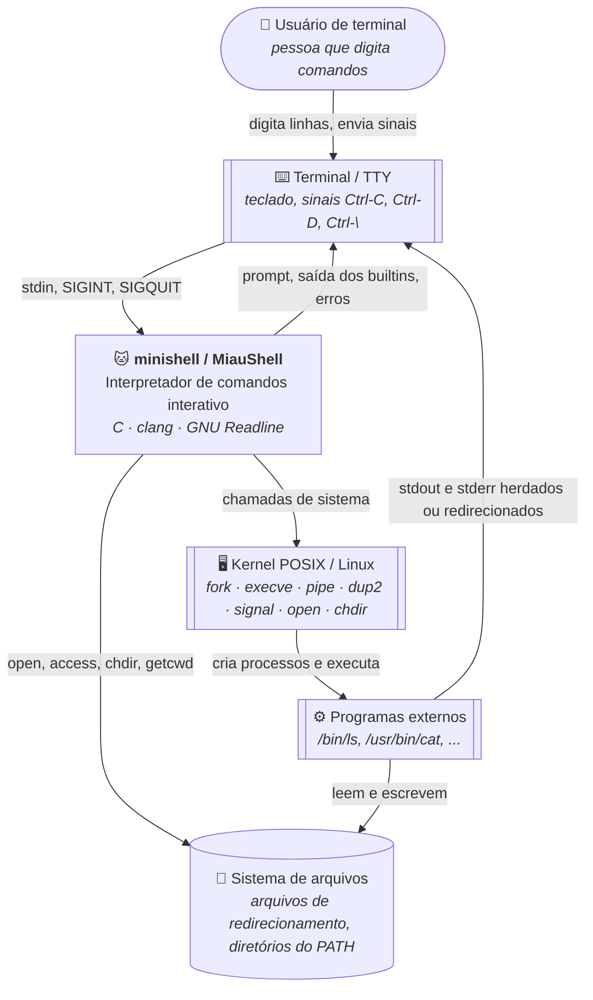

# C4 Nível 1: Contexto

> Gerado pelo **Arquiteto** (Reversa) em 2026-11-11 · 🟢 salvo indicação em contrário

| Elemento | Tipo | Descrição |
|----------|------|-----------|
| Usuário de terminal | Pessoa | Única persona. Não há papéis nem autenticação |
| minishell | Sistema (foco) | Processo único e interativo, que lê do stdin com readline |
| Kernel POSIX | Sistema externo | Toda a "integração" se dá por chamadas de sistema |
| Programas externos | Sistema externo | Qualquer executável alcançável por caminho ou pelo `PATH` |
| Sistema de arquivos | Armazenamento | Alvos de `<`, `>`, `>>`, diretórios do `PATH` e do `cd` |
| Terminal | Dispositivo | Origem da entrada e dos sinais. O shell assume que é um TTY interativo 🟡 |

**Integrações de rede, APIs, filas ou banco de dados:** nenhuma 🟢.
