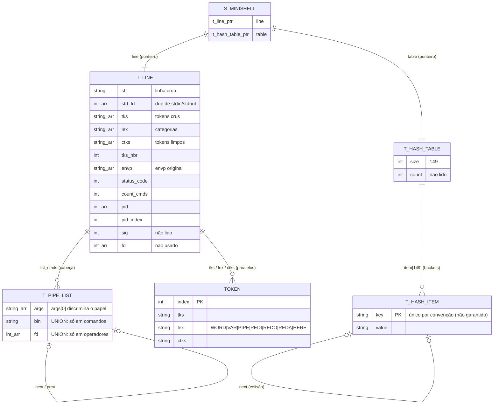

# ERD: modelo de dados em memória

> Gerado pelo **Arquiteto** (Reversa) em 2026-11-11
> O minishell não tem banco de dados. Este ERD representa as **estruturas em memória** e suas relações. Os campos estão detalhados em `data-dictionary.md`.

## Cardinalidades e invariantes

| Relação | Cardinalidade | Invariante esperada | Garantida? |
|---------|---------------|---------------------|------------|
| `s_minishell` → `t_line` | 1:1 | Instância única | 🟢 sim |
| `t_line` → `t_pipe_list` | 1:0..N | Lista vazia em linha só com espaços | 🟢 |
| `t_pipe_list` ↔ `t_pipe_list` | encadeamento duplo | `n.next.prev == n` | 🟢 (`add_back_list`) |
| `t_line` → tokens | 1:N | `len(tks) == len(lex) == len(ctks) == tks_nbr` | 🟡 depende de `count_tks` e `tokenizer` concordarem |
| `t_hash_table` → `t_hash_item` | 1:0..N | **Chave única** | ✗ inserção só deduplica contra a cabeça do bucket (🟢) |
| `T_HASH_ITEM.key` | — | Sempre existe `"?"` | 🟢 |

*TOKEN não é uma struct real: representa as posições `i` dos três arrays paralelos (ADR-003).*
