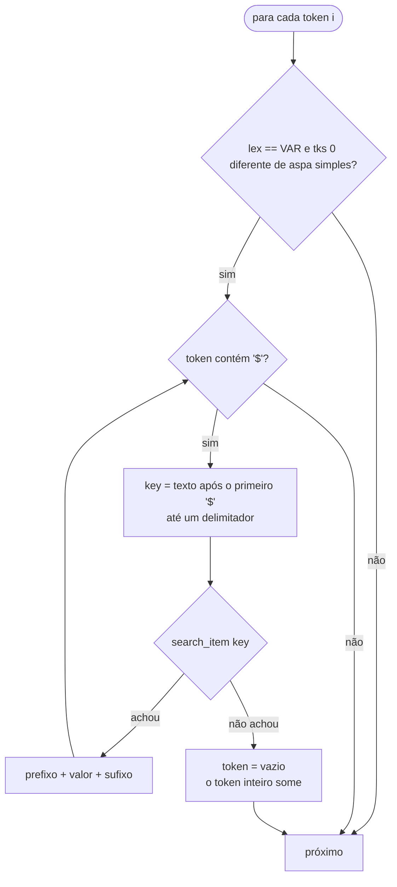
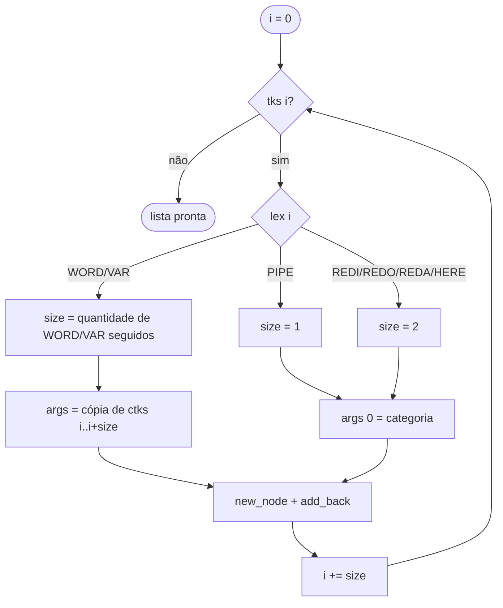
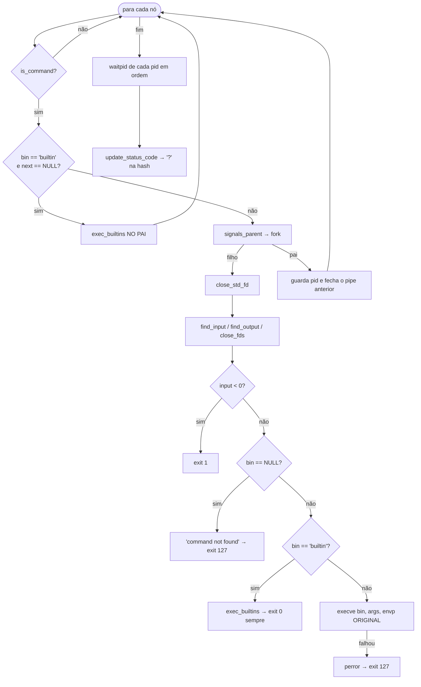
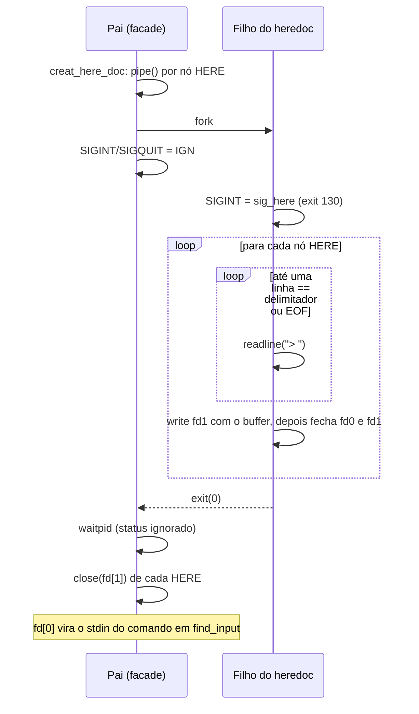

# Fluxograma: módulo `exec`

> Arqueólogo · 2026-11-11 · 🟢 extraído de `src/exec/*.c`

## Expansão (`expand_var`)

## Montagem da lista (`creat_list_cmd`)

## Execução (`exec_list` / `init_fork` / `exec_path`)

## Heredoc

