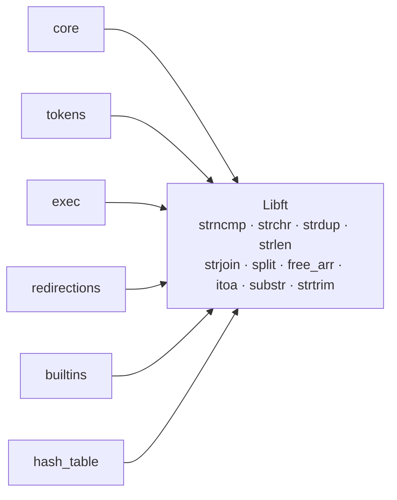

# Fluxograma: módulo `libft`

> Arqueólogo · 2026-11-11 · análise leve

A Libft é uma biblioteca de funções puras de string e memória, sem fluxo de controle relevante para o domínio. Dependência entre os módulos do minishell e a Libft:

Particularidades que afetam o comportamento do shell:
- `ft_split` descarta campos vazios: `export A=` não grava nada, e `A==b` vira `A=b`.
- `ft_free_arr(NULL)` causa segfault.
- `ft_strcmp` retorna 1 quando as strings são iguais (não é usada em `src/`).
