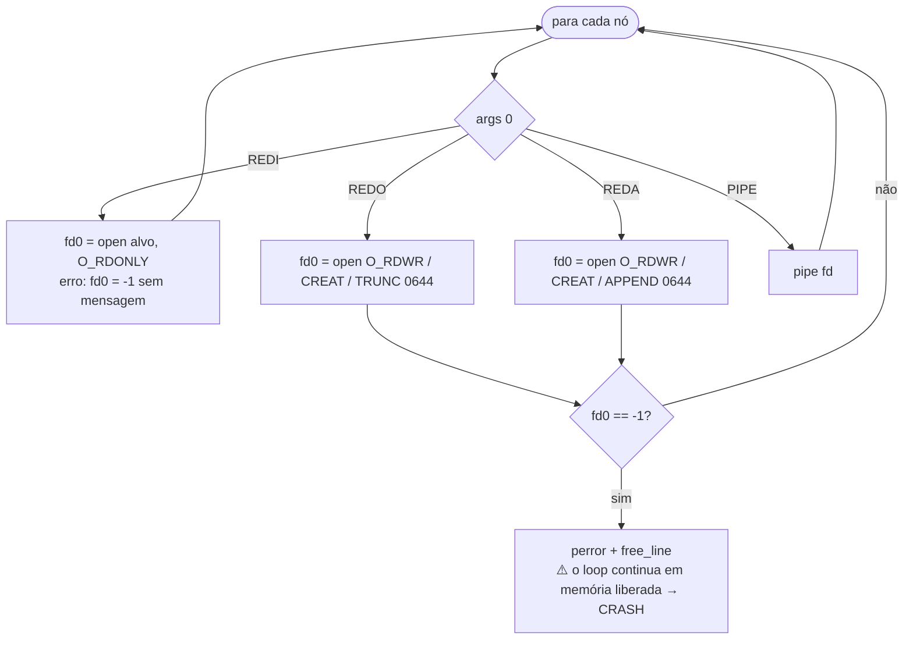
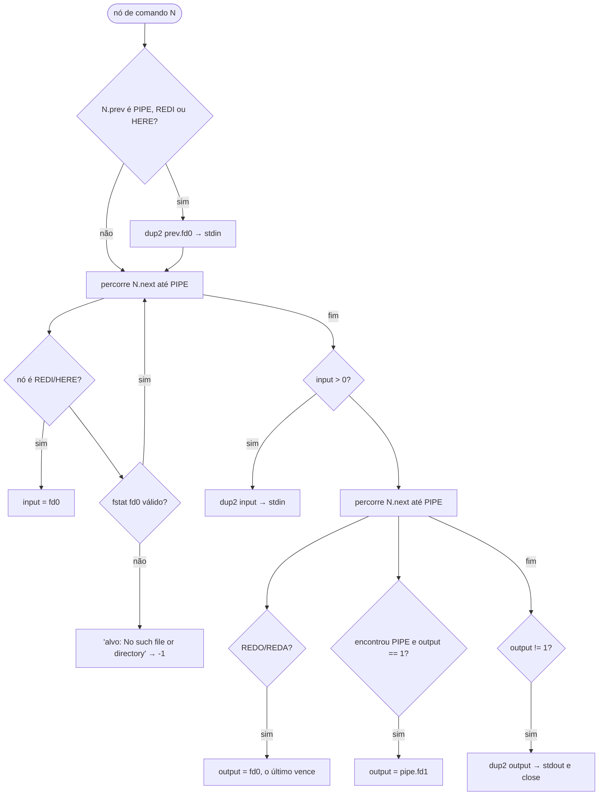

# Fluxograma: módulo `redirections`

> Arqueólogo · 2026-11-11 · 🟢 extraído de `src/fd_handler.c` e `src/fd_handler_utils.c`

## Abertura no pai (`open_fds`)

## Ligação no filho (`find_input` / `find_output`)

Observação: só o nó **imediatamente anterior** ao comando é olhado para entrada, e **nenhum** nó anterior é olhado para saída. Por isso `> f cmd` não redireciona a saída.
