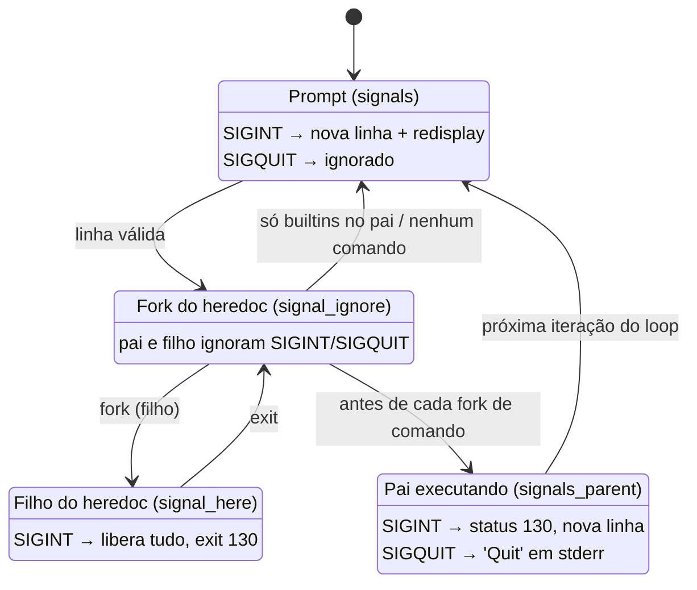

# Fluxograma: módulo `signals`

> Arqueólogo · 2026-11-11 · 🟢 extraído de `src/signals.c` e `src/signals_utils.c`

Os filhos que fazem `execve` voltam ao comportamento padrão dos sinais. Os filhos que executam builtins herdam `sig_parent`/`sig_write`.
