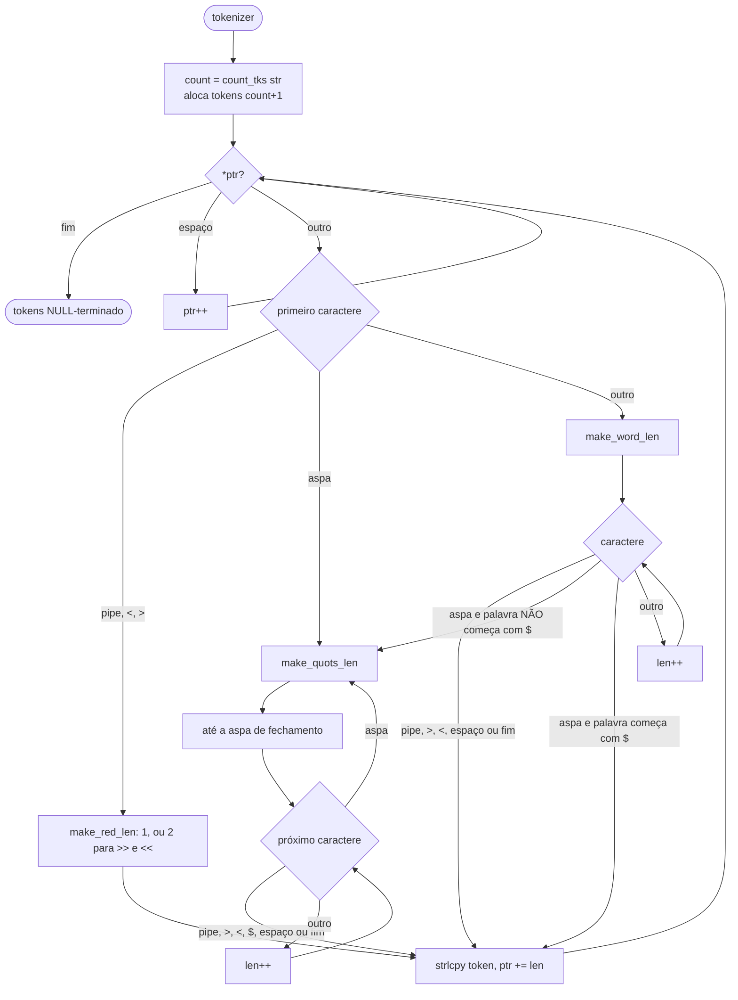
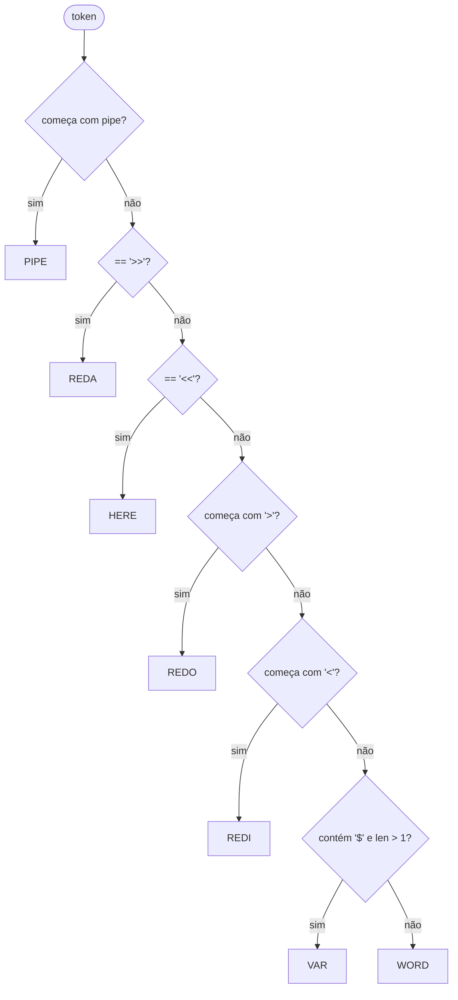
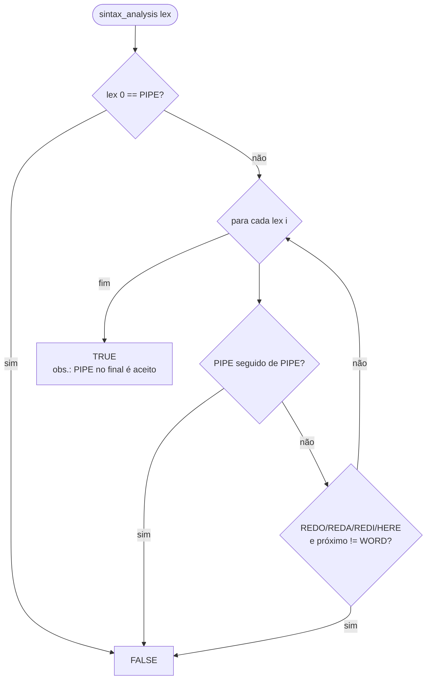
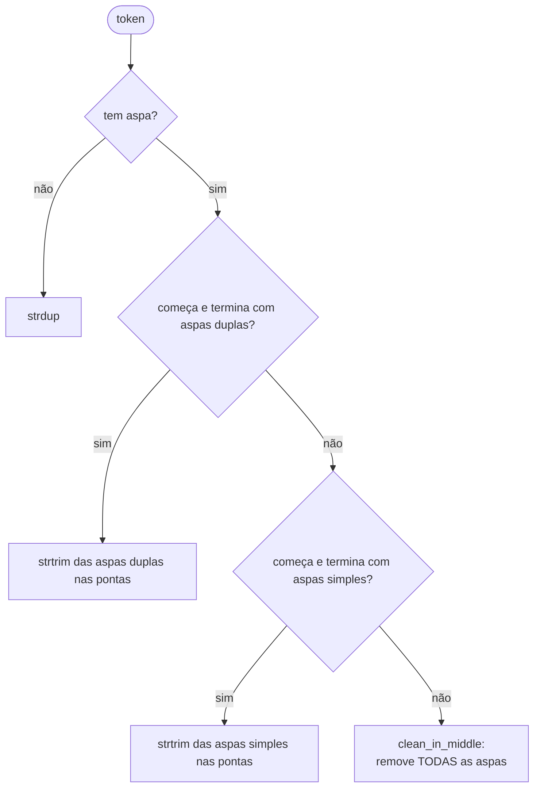

# Fluxograma: módulo `tokens`

> Arqueólogo · 2026-11-11 · 🟢 extraído de `src/tokens/*.c`

## Tokenização (`tokenizer` / `worddup`)

## Classificação léxica e sintaxe

## Remoção de aspas (`clean_tokens`)

