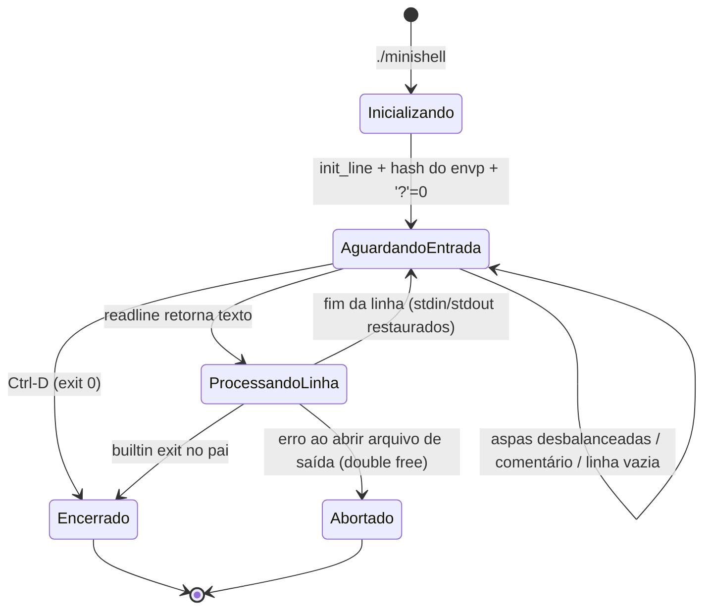
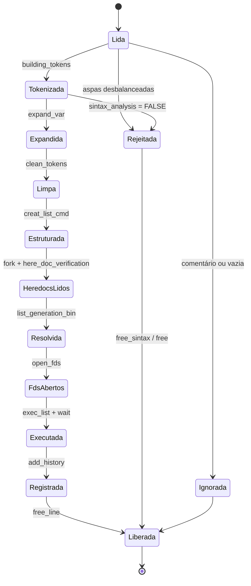
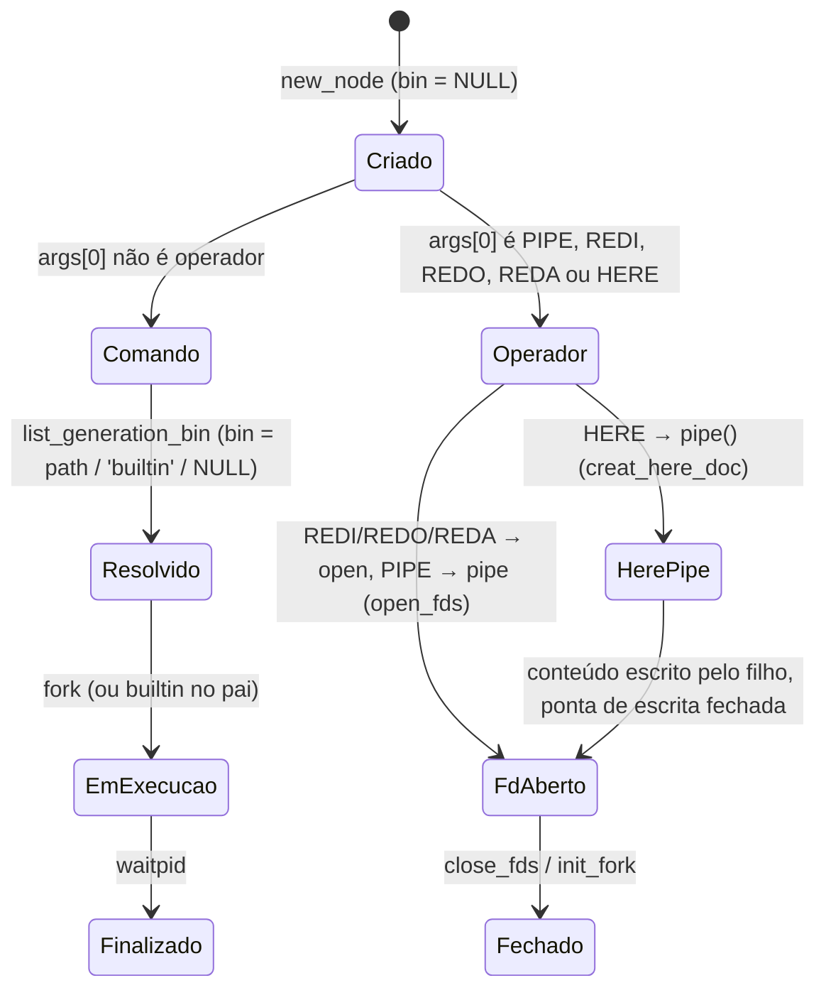
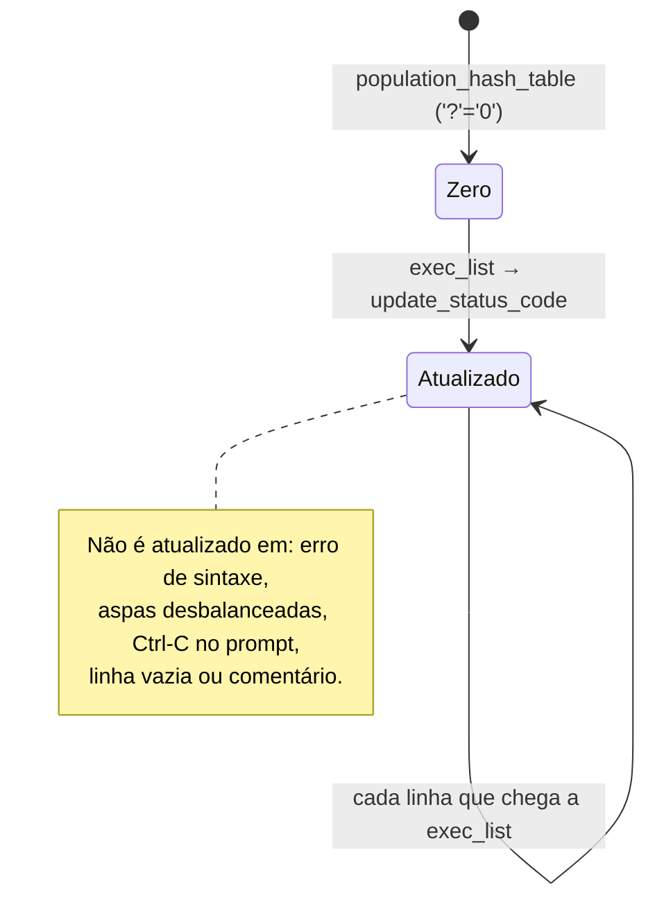

# Máquinas de Estado — minishell

> Gerado pelo **Detetive** (Reversa) em 2026-11-11
> Escala: 🟢 CONFIRMADO · 🟡 INFERIDO · 🔴 LACUNA

O minishell não tem entidades persistentes com campo de status. As "máquinas de estado" relevantes são o **ciclo de vida da sessão**, o **ciclo de vida de uma linha**, o **contexto de sinais** e o **valor de `$?`**.

---

## 1. Sessão do shell (processo principal)

| Transição | Gatilho | Local | Confiança |
|-----------|---------|-------|-----------|
| Inicializando → AguardandoEntrada | `main` concluído | `main.c:21-34` | 🟢 |
| AguardandoEntrada → Encerrado | `readline` retorna `NULL` | `main.c:65-74` | 🟢 |
| ProcessandoLinha → Encerrado | `exit` como último nó (inclusive `ls \| exit`) | `exit.c:58-60`, `exec_list.c:30` | 🟢 |
| ProcessandoLinha → Abortado | `open` de `>`/`>>` falha | `fd_handler_utils.c:51-55` | 🟢 (observado) |

---

## 2. Ciclo de vida de uma linha (`t_line`)

Campos de `t_line` preenchidos em cada estado:

| Estado | `str` | `tks` | `lex` | `ctks` | `list_cmds` | `pid` |
|--------|:-----:|:-----:|:-----:|:------:|:-----------:|:-----:|
| Lida | ✔ | | | | | |
| Tokenizada | ✔ | ✔ | ✔ | | | |
| Expandida | ✔ | ✔* | ✔ | | | |
| Limpa | ✔ | ✔ | ✔ | ✔ | | |
| Estruturada / HeredocsLidos / Resolvida | ✔ | ✔ | ✔ | ✔ | ✔ | |
| FdsAbertos / Executada | ✔ | ✔ | ✔ | ✔ | ✔ | ✔ |
| Liberada | ✘ | NULL | NULL | NULL | NULL | NULL |

\* `tks` é alterado no lugar 🟢.

---

## 3. Papel de um nó (`t_pipe_list`)

O papel é decidido uma vez, na criação, por `args[0]`, e não muda depois. Os campos ativos é que mudam ao longo do processamento:

🟢 extraído de `make_list.c`, `here_doc_utils.c`, `fd_handler_utils.c`, `exec_list.c`, `init_fork.c`.

---

## 4. Contexto de sinais

Está detalhado em `flowcharts/signals.md`. Resumo:

| Estado | SIGINT | SIGQUIT | Entrada por |
|--------|--------|---------|-------------|
| `PROMPT` | novo prompt | ignorado | `signals()` |
| `IGNORANDO` | ignorado | ignorado | `signal_ignore()` (fork do heredoc) |
| `HEREDOC_FILHO` | `exit(130)` | ignorado | `signal_here()` |
| `EXECUTANDO` | `\n`, status 130 | `Quit` | `signals_parent()` |

O campo `t_line.sig` recebe 0 em cada troca de contexto, mas **nunca é lido**. Parece ser vestígio de uma máquina de estados abandonada 🟡.

---

## 5. Valor de `$?` (chave `"?"`)

Fonte do valor (`line->status_code`), em ordem de sobrescrita dentro de uma linha:
1. `waitpid` do heredoc. É sempre executado, e normalmente dá 0 🟢.
2. Builtin no pai escreve 1 ou 127 em caso de erro 🟢.
3. `sig_parent` escreve 130 🟢.
4. `waitpid` de cada filho (o último vence) 🟢.

O valor final é convertido: `WEXITSTATUS`, ou `128 + WTERMSIG`, ou o valor bruto 🟢.
