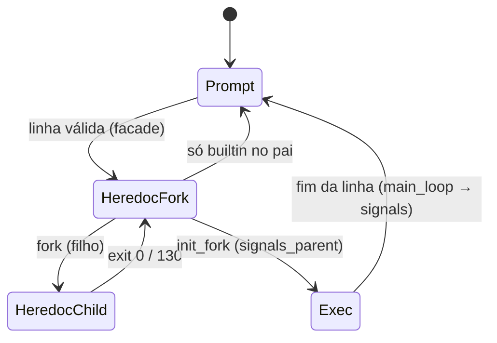

# Tratar Sinais: Design Técnico

> Unit de caso de uso · Redator (Reversa) · 2026-11-22
> Escala: 🟢 CONFIRMADO · 🟡 INFERIDO · 🔴 LACUNA · ⚠️ DIVERGÊNCIA em relação ao bash

## Interface

| Símbolo | Onde é instalado | SIGINT | SIGQUIT |
|---------|------------------|--------|---------|
| `signals(line)` | início de cada iteração de `main_loop` (`src/main.c:44`) | `sig_handler` | `SIG_IGN` |
| `signal_ignore(line)` | pai e filho, logo depois do fork do heredoc (`src/facade.c:41`) | `SIG_IGN` | `SIG_IGN` |
| `signal_here(line)` | filho do heredoc (`src/facade.c:44`) | `sig_here` | (herdado: `SIG_IGN`) |
| `signals_parent(line)` | pai, antes de cada fork de comando (`src/exec/init_fork.c:15`) | `sig_parent` | `sig_write` |

| Handler | Ação | Arquivo |
|---------|------|---------|
| `sig_handler` | `write(2, "\n")`, `rl_on_new_line`, `rl_replace_line("", 0)`, `rl_redisplay` | `src/signals_utils.c:45-55` 🟢 |
| `sig_here` | `printf("\n")`; em SIGINT: `close_std_fd`, `free_line`, `free_table`, `exit(130)` | `src/signals_utils.c:23-33` 🟢 |
| `sig_parent` | em SIGINT: `status_code = 130`, `write(2, "\n")`, `rl_on_new_line` | `src/signals.c:17-25` 🟢 |
| `sig_write` | em SIGQUIT: `write(2, "Quit\n")` | `src/signals.c:27-31` 🟢 |

Todas as funções também zeram `line->sig`, campo que não é lido em nenhum lugar 🟡.

## Fluxo Principal (máquina de estados)

1. **Prompt:** `readline` bloqueado; Ctrl-C → `sig_handler` limpa a linha e redesenha; `$?` não muda (nenhum `status_code` é gravado) 🟢
2. **HeredocFork:** o pai ignora tudo enquanto espera o filho do heredoc e até o primeiro `init_fork` 🟢
3. **Exec:** `signals_parent` é reinstalado a cada fork. O terminal envia o sinal ao grupo de processos inteiro (shell + filhos):
   - os filhos com `execve` usam a ação padrão e morrem
   - o shell roda `sig_parent`/`sig_write`, e `waitpid` (com `SA_RESTART`) continua esperando
   - `update_status_code` grava `128 + sinal` 🟢 (observado: 130 e 131)
4. De volta a `main_loop`, `signals` reinstala o tratamento do prompt 🟢

## Fluxos Alternativos
- **Builtin no pai** (sem fork de comando): continua com `SIG_IGN` herdado de `signal_ignore` durante a execução do builtin; Ctrl-C nesse intervalo é ignorado 🟢
- **Builtin em filho:** herda `sig_parent`; Ctrl-C não o mata, só grava 130 numa cópia da linha e escreve `\n` 🟡
- **Ctrl-\ com `sleep`:** o kernel gera *core dump* conforme o `ulimit`; o shell só escreve `Quit` 🟢

## Dependências
- **GNU Readline:** `rl_on_new_line`, `rl_replace_line`, `rl_redisplay`
- **Global `g_minishell`** (ADR-007): acesso à linha e à tabela dentro dos handlers
- **ler-heredoc, executar-comando-simples:** pontos de troca de handler
- **POSIX:** `signal`, `exit`, `write`

## Decisões de Design Identificadas

| Decisão | Evidência no código | Confiança |
|---------|---------------------|-----------|
| Troca de handlers por fase em vez de um handler único com estado | `src/signals*.c` | 🟢 |
| Global única para os handlers (exigência da 42: no máximo uma global) (ADR-007) | `src/main.c:15` | 🟢 |
| `signal()` em vez de `sigaction()` | `src/signals*.c` | 🟢 |
| `$?=130` do prompt **não** implementado (o handler do prompt não grava `status_code`) | `src/signals_utils.c:45-55` | 🟢 |

## Estado Interno
`g_minishell.line->status_code` (gravado por `sig_parent`, mas sobrescrito por `waitpid`) 🟢.

## Observabilidade
`\n` e `Quit\n` em stderr 🟢.

## Riscos e Lacunas
- 🟢 SG-02: Ctrl-C no prompt não grava `$?=130`
- 🟢 BUG-15: Ctrl-C no heredoc não cancela a linha
- 🟢 Handlers com funções não *async-signal-safe* (`printf` em `sig_here`, `rl_*`, `free`); risco de *deadlock* raro
- 🟡 `sig_parent` grava 130 em `status_code`, mas o valor é sempre sobrescrito pelo `waitpid` seguinte; só tem efeito se nenhum filho for esperado
- ✅ L-07 (decidida em 2026-11-22): documentar o as-is. Nota para uma eventual reimplementação corretiva, fora do escopo atual: alinhar com o bash (`$?=130` no prompt, `Quit (core dumped)`, cancelamento do heredoc)
